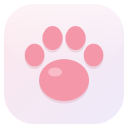

<p align="center">
  
</p>

<h1 align="center">Muzzle</h1>

<p align="center">
  A cozy, minimalist, pastel design system for WPF, with <b>jelly physics</b> on every interactive control.
</p>

<p align="center">
  <a href="https://www.nuget.org/packages/Muzzle.Theme"></a>
  <a href="https://github.com/MrSquirrely/MuzzleUI/actions/workflows/ci.yml"></a>
  <a href="https://github.com/MrSquirrely/MuzzleUI/blob/main/LICENSE"></a>
  
</p>

## Overview

**Muzzle.Theme** restyles every standard WPF control and adds 40+ custom ones (toasts, dialogs, drawers, a command palette, pickers, a property grid, a carousel and more). Its look is soft, rounded and pastel. Buttons squish when pressed and spring back with an elastic overshoot, and selection pills slide and stretch. Popups bounce open, and toasts glide in.

- **Light and Dark** palettes ("Pastel Twilight") with identical keys, plus a **System** mode that follows Windows.
- **Four accents**: Coral, Lavender, Mint and Peach. You can also use any custom colour, and Muzzle derives a full ramp from it. Theme and accent switch at runtime, with an optional crossfade.
- **Everything goes through `DynamicResource` tokens** (`Muzzle.Brush.*`, `Muzzle.Color.*`, `Muzzle.Shadow.*`), so switching restyles every open window, popup and overlay.
- **Accessible by default**:
  - full keyboard navigation and a visible focus ring;
  - UI Automation names and screen-reader announcements;
  - a calm mode (`JellyIntensity = 0`) that also honours the Windows *Show animations* setting;
  - the embedded [Atkinson Hyperlegible Next](https://github.com/googlefonts/atkinson-hyperlegible-next) font, designed for low-vision readers.
- **Desktop-ready helpers**:
  - a custom `MuzzleWindow` with Windows 11 snap layouts;
  - Mica and Acrylic backdrops;
  - window-placement saving;
  - a XAML tray icon.

It targets `net10.0-windows` and has no third-party dependencies.

## Quick start

### 1. Install

```powershell
dotnet add package Muzzle.Theme
```

### 2. Merge the theme in App.xaml

The simplest option is one element, with a theme (`Light`, `Dark` or `System`) and an accent:

```xml
<Application x:Class="MyApp.App"
             xmlns="http://schemas.microsoft.com/winfx/2006/xaml/presentation"
             xmlns:x="http://schemas.microsoft.com/winfx/2006/xaml"
             xmlns:mz="http://schemas.muzzle.dev/wpf"
             StartupUri="MainWindow.xaml">
    <Application.Resources>
        <mz:MuzzleThemeResourceDictionary Theme="System" Accent="Lavender">
            <!-- Your own resources can live in here too. -->
        </mz:MuzzleThemeResourceDictionary>
    </Application.Resources>
</Application>
```

Or use a plain merged dictionary. That gives you Light with the Coral accent, and you can switch later from code:

```xml
<Application.Resources>
    <ResourceDictionary>
        <ResourceDictionary.MergedDictionaries>
            <ResourceDictionary Source="pack://application:,,,/Muzzle.Theme;component/Themes/Muzzle.xaml" />
        </ResourceDictionary.MergedDictionaries>
    </ResourceDictionary>
</Application.Resources>
```

Every standard control is now styled. For the custom controls, attached properties and converters, add `xmlns:mz="http://schemas.muzzle.dev/wpf"`.

### 3. Use the controls

```xml
<mz:MuzzleWindow x:Class="MyApp.MainWindow"
                 xmlns="http://schemas.microsoft.com/winfx/2006/xaml/presentation"
                 xmlns:x="http://schemas.microsoft.com/winfx/2006/xaml"
                 xmlns:mz="http://schemas.muzzle.dev/wpf"
                 Title="Cat café" Width="900" Height="600"
                 mz:WindowStateSaver.Key="MainWindow">
    <StackPanel Margin="24">
        <TextBlock Style="{StaticResource Muzzle.Text.Title}" Text="Welcome back" />
        <TextBox mz:MuzzleAssist.Placeholder="Your cat's name" Margin="0,12" />
        <mz:ToggleSwitch Content="Extra treats" />
        <Button Style="{StaticResource Muzzle.Button.Primary}" Content="Adopt" Margin="0,12" />
    </StackPanel>
</mz:MuzzleWindow>
```

```csharp
public partial class MainWindow : MuzzleWindow {
    public MainWindow() {
        InitializeComponent();
    }
}
```

### 4. Switch theme and accent at runtime

```csharp
MuzzleThemeManager.ApplyTheme(MuzzleTheme.Dark);                       // instant
MuzzleThemeManager.ApplyTheme(MuzzleTheme.System, animate: true);      // follow Windows, crossfading
MuzzleThemeManager.ApplyAccent(MuzzleAccent.Mint, animate: true);
MuzzleThemeManager.ApplyCustomAccent(Color.FromRgb(0x5F, 0xA8, 0xD3)); // a full ramp is derived

MuzzleThemeManager.ThemeChanged += (_, e) => Debug.WriteLine($"{e.Theme} -> {e.EffectiveTheme}");
MuzzleThemeManager.AccentChanged += (_, e) => Debug.WriteLine(e.Accent);
```

Theme and accent are independent: changing one keeps the other. To let users choose, drop `<mz:ThemeToggleButton />` (it cycles Light → Dark → System) or `<mz:AccentSwatch Accent="Peach" />` anywhere. Your own resources follow the theme when you use `{DynamicResource Muzzle.Brush.*}`.

## Guides

### MuzzleWindow

A borderless window with rounded corners and jelly caption buttons. It supports Windows 11 snap layouts (hover the maximise button) and per-monitor DPI. Put anything in the title bar: interactive elements stay clickable, and empty space still drags the window.

```xml
<mz:MuzzleWindow Title="My app" NonClientAreaHeight="48" ShowIcon="False">
    <mz:MuzzleWindow.NonClientAreaContent>
        <StackPanel Orientation="Horizontal" HorizontalAlignment="Right">
            <TextBox Width="220" mz:MuzzleAssist.Placeholder="Search…" />
            <mz:ThemeToggleButton Margin="8,0" />
        </StackPanel>
    </mz:MuzzleWindow.NonClientAreaContent>
    ...
</mz:MuzzleWindow>
```

Properties include `NonClientAreaContent`, `NonClientAreaHeight`, `NonClientAreaBackground`, `NonClientAreaForeground`, `IsFullScreen`, `ShowTitle`, `ShowIcon`, `ShowMinimizeButton` and `ShowMaximizeButton`. The caption buttons follow `ResizeMode`.

### Growl (toasts)

Mark any panel as a toast host, then call the static API from anywhere, including background threads:

```xml
<Grid mz:Growl.GrowlParent="True"> ... </Grid>
<Grid mz:Growl.GrowlParent="True" mz:Growl.Token="Sidebar" />   <!-- a named host -->
```

```csharp
Growl.Success("Saved your settings", title: "Done");
Growl.Warning("Only 4 treats left", token: "Sidebar", waitTime: TimeSpan.FromSeconds(6));
Growl.Fatal("The litter box is full");                  // stays until dismissed
Growl.Ask("Delete this cat photo?", confirmed => { if (confirmed) { Delete(); } });
Growl.Show(new GrowlInfo { Message = "Desktop toast", IsGlobal = true });
Growl.ClearAll();
```

Toasts spring in, show a countdown line that pauses on hover, and glide their neighbours up as they leave. If there is no host (or `IsGlobal` is set), they appear in a click-through window in the desktop's top-right corner.

### Dialog

A modal overlay over the active window's client area; the title bar stays usable. Focus is trapped inside, and the content beneath leaves the tab order.

```csharp
Dialog.Show(new AboutPanel());
CatProfile? result = await Dialog.ShowAsync<CatProfile>(new EditCatForm());
Dialog.Close();
```

Close it from inside the content:

- call `Dialog.GetDialog(this)?.CloseWithResult(value)`;
- bind a button to `{x:Static mz:Dialog.CloseCommand}` (its `CommandParameter` is the result);
- or implement `IDialogResultable<T>` on the content or its DataContext.

`CloseOnEscape` defaults to true. `CloseOnBackdropClick` defaults to false, so the dialog wobbles instead. Host dialogs in a region with `<mz:DialogContainer mz:Dialog.Token="…">`.

### Drawer

An edge panel that springs in over a mask, from any of the four sides.

```xml
<mz:DrawerContainer>
    <ToggleButton IsChecked="{Binding IsOpen, ElementName=Settings}" Content="Settings" />
    <mz:Drawer x:Name="Settings" Dock="Right" DrawerSize="320" Header="Settings"
               ShowMask="True" MaskCanClose="True">
        ...
    </mz:Drawer>
</mz:DrawerContainer>
```

```csharp
Drawer drawer = Drawer.Show(new FiltersPanel(), Dock.Left, header: "Filters"); // over the active window
drawer.IsOpen = false;                                                         // slides out and removes itself
```

### CommandPalette

A Ctrl+K launcher with fuzzy search. Place it over a window's content and give it items:

```xml
<Grid>
    <!-- page content -->
    <mz:CommandPalette ItemsSource="{Binding Commands}" ShortcutGesture="Ctrl+K" ItemInvoked="OnPaletteItemInvoked" />
</Grid>
```

```csharp
List<CommandPaletteItem> commands = [
    new() { Title = "New cat profile", Category = "Cats", Icon = MuzzleIconKind.Paw, Shortcut = "Ctrl+N", Command = NewCatCommand },
    new() { Title = "Toggle dark mode", Keywords = "theme night", Icon = MuzzleIconKind.Moon, Command = ToggleThemeCommand }
];
```

It works with both keyboard and mouse:

- ↑ / ↓ and PageUp / PageDown move through the results.
- Enter or a click runs the item: the palette closes, runs `Command`, then raises `ItemInvoked`.
- Esc or a backdrop click closes it.

`Open()`, `Close()` and `IsOpen` control it from code. `CommandPalette.FuzzyScore` is public if you want the same ranking elsewhere.

## Behaviors and helpers

All of these are attached properties in the `mz` namespace, so they work on any element without retemplating.

| Helper | Example | What it does |
|---|---|---|
| **`JellyBehavior`** | `mz:JellyBehavior.EnableHoverBounce="True"`, `EnablePressSquish`, `EntranceAnimation="PopIn"` | Adds a hover bounce (`HoverScale`, 1.03), a press squish (`PressSquishScale`, 0.94) and a `Loaded` entrance (`PopIn`, `SlideUp` or `FadeIn`, with `EntranceDelay` for staggering). `JellyBehavior.PlayEntrance(element)` replays it. |
| **`MuzzleAssist`** | `mz:MuzzleAssist.CornerRadius="18"`, `ShadowDepth="Floating"`, `JellyIntensity="2"` | The everyday styling knobs. **`CornerRadius`** (999 makes a pill) and **`ShadowDepth`** (`Subtle` → `Floating`) set the shape and elevation. **`JellyIntensity`** (inherited; 0 = calm) and **`Jelly`** (`Hover, Press, Focus, Toggle`) control the motion. **`Placeholder`** and **`Badge`** / **`BadgeKind`** add hint text and a count pill. **`HoverBackground`** / **`PressedBackground`** set button colours. |
| **`ClipHelper`** | `mz:ClipHelper.CornerRadius="20"` | Keeps a rounded clip in step with the element's size. On a `Border`, it clips the child inside the border and padding, so images never bleed past the corners. |
| **`ScrollViewerAssist`** | `mz:ScrollViewerAssist.EnableSmoothScroll="True"`, `EnableShiftHorizontalScroll="True"` | Glides to the wheel target (`WheelStep`, 96 DIP) and makes Shift + wheel scroll sideways. At the ends it hands the wheel to the outer scroller. |
| **`WindowStateSaver`** | `mz:WindowStateSaver.Key="MainWindow"` | Saves a window's bounds and maximised state to `%LOCALAPPDATA%\<app>\window-state.json` and restores them on the next run. If the saved spot is on a disconnected monitor, the window is centred instead. |
| **`BackdropHelper`** | `mz:BackdropHelper.BackdropType="Mica"` | Windows 11 system backdrops (`Mica`, `Acrylic`, `Tabbed`) with a translucent, theme-aware canvas. Set `mz:BackdropHelper.TintBackground="False"` to keep your own window background. On older Windows it does nothing; check `BackdropHelper.IsSupported`. |
| `FocusTrap`, `EscapeKeyBehavior` | `mz:FocusTrap.IsEnabled="True"`, `mz:EscapeKeyBehavior.IsOpen="{Binding IsOpen}"` | Keep Tab cycling inside a panel, and close it on Esc. |

From code, `Jelly.Wobble(element)` plays a "no" wobble, and `MuzzleEasings.Get(element, MuzzleEasings.JellyKey)` returns the signature spring.

## Control catalogue

Every standard control is restyled automatically. Explicit styles such as `Muzzle.Button.Primary` give you variants. The `mz:` controls are new.

| Category | Controls |
|---|---|
| **Buttons and toggles** | Button (`.Primary`, `.Secondary`, `.Mint`, `.Ghost`, `.Pill`, `.Icon`), ToggleButton, RepeatButton, `mz:ToggleSwitch`, CheckBox, RadioButton, `mz:SplitButton`, `mz:DropDownButton`, `mz:ThemeToggleButton`, `mz:AccentSwatch` |
| **Text and inputs** | TextBox, PasswordBox, ComboBox, Slider, `mz:NumericUpDown`, `mz:TagInput`, `mz:SearchBar`, `mz:RangeSlider`, `mz:PasswordStrengthMeter` |
| **Pickers** | DatePicker, Calendar, `mz:TimePicker`, `mz:ColorPicker`, `mz:ColorPickerDropDown`, `mz:Rating` |
| **Overlays and notifications** | `mz:Growl` toasts, `mz:Dialog`, `MessageBox` (a blocking, owner-modal window), `mz:Drawer`, `mz:CommandPalette`, `mz:Popover`, ToolTip, ContextMenu and Menu |
| **Feedback and status** | ProgressBar, `mz:LoadingSpinner`, `mz:Skeleton`, `mz:Badge`, `mz:InfoBar`, `mz:EmptyState` |
| **Navigation and layout** | TabControl, Expander, `mz:NavigationView`, `mz:BreadcrumbBar`, `mz:Pagination`, `mz:StepBar`, `mz:TransitioningContentControl`, `mz:Card`, GridSplitter, ScrollViewer |
| **Data and media** | DataGrid (with Muzzle column editors), ListBox, TreeView, `mz:PropertyGrid`, `mz:Avatar`, `mz:Carousel`, `mz:ImageViewer` |
| **Text and code** | `Muzzle.Text.*` typography styles, `mz:CodeBlock`, `mz:CopyableText`, `mz:Keycap`, `mz:ShortcutBadge`, `mz:MuzzleIcon` (156 icons) |
| **Windows and system** | `mz:MuzzleWindow`, `mz:SystemTrayIcon`, `WindowStateSaver`, `BackdropHelper` |

Every control's properties, events, keys and motion details are in **[docs/REFERENCE.md](https://github.com/MrSquirrely/MuzzleUI/blob/main/docs/REFERENCE.md)**. The gallery app demonstrates all of them with copy-pasteable XAML.

## Building from source

You need the .NET 10 SDK on Windows.

```powershell
git clone https://github.com/MrSquirrely/MuzzleUI.git
```

```powershell
dotnet build Muzzle.slnx
```

```powershell
dotnet test tests/Muzzle.Theme.Tests
```

```powershell
dotnet run --project src/Muzzle.Gallery
```

```powershell
dotnet pack src/Muzzle.Theme -c Release -o artifacts
```

The pack command writes `Muzzle.Theme.<version>.nupkg` and a `.snupkg` symbols package. The build includes XML docs, deterministic output and SourceLink.

| Folder | Contents |
|---|---|
| `src/Muzzle.Theme` | The library: `Themes/` (palettes, accents, tokens, one dictionary per control), `Controls/`, `Behaviors/`, `Windowing/`, `Converters/` |
| `src/Muzzle.Gallery` | The showcase app. `Muzzle.Gallery.exe --snapshot <dir>` renders every page to PNG for visual checks |
| `tests/Muzzle.Theme.Tests` | The xUnit suite: 234 tests |
| `tools/` | Generators for the palettes, icons and package icon. Edit their tables, not the generated files |
| `docs/` | The full reference |

Contributions go to the `dev` branch. `main` is released automatically: every merge publishes a GitHub Release and the NuGet package. Coding agents should read [AGENTS.md](https://github.com/MrSquirrely/MuzzleUI/blob/main/AGENTS.md) first.

## Licence

Muzzle is released under the [MIT licence](https://github.com/MrSquirrely/MuzzleUI/blob/main/LICENSE). The embedded Atkinson Hyperlegible Next font is © Braille Institute of America and is licensed under the SIL Open Font License 1.1; the licence text ships in the package's `licenses/` folder.